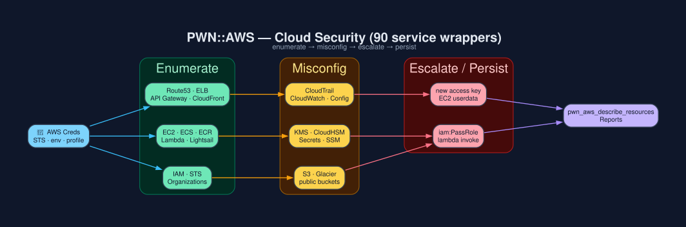

# `PWN::AWS` - Cloud Security (90 service wrappers)

One thin module per AWS service, each wrapping the official `aws-sdk-*` gem
with the PWN `opts = {}` convention so they compose in the REPL and in
`pwn_eval`.



## Credentials

Service wrappers expose `connect`/`disconnect`, not every AWS SDK operation
as a PWN module method. Supply `region`, `access_key_id`, `secret_access_key`
and optional `sts_session_token` to `connect`; retrieve credentials through
your approved secret source without printing them. `STS.get_temp_credentials`
is the separate assume-role helper. Inspect each module's `.help` first.

## Quick enumeration

```ruby
# credentials is an operator-supplied Hash; never log its values.
ec2 = PWN::AWS::EC2.connect(credentials.merge(region: 'us-east-1'))
instances = ec2.describe_instances
PWN::AWS::EC2.disconnect(ec2_obj: ec2)
```

CLI: `pwn_aws_describe_resources -r us-east-1 -c /path/to/private-aws.yaml`

## Service groups

| Group | Modules |
|---|---|
| Identity | `IAM` `STS` `CognitoIdentity` `CognitoIdentityProvider` `CognitoSync` `DirectoryService` |
| Compute | `EC2` `ECS` `ECR` `Lambda` `LambdaPreview` `Batch` `Lightsail` `ElasticBeanstalk` `AutoScaling` `ApplicationAutoScaling` `AppStream` |
| Storage | `S3` `Glacier` `EFS` `StorageGateway` `Snowball` |
| Data | `DynamoDB` `DynamoDBStreams` `RDS` `Redshift` `ElastiCache` `SimpleDB` `ElasticsearchService` |
| Network | `Route53` `Route53Domains` `ElasticLoadBalancing` `ElasticLoadBalancingV2` `APIGateway` `CloudFront` `DirectConnect` `WAF` `WAFRegional` `Shield` |
| Crypto | `KMS` `CloudHSM` `ACM` |
| Ops / Logs | `CloudTrail` `CloudWatch` `CloudWatchLogs` `CloudWatchEvents` `ConfigService` `SSM` `Health` `Inspector` `XRay` |
| Dev | `CodeBuild` `CodeCommit` `CodeDeploy` `CodePipeline` |
| Messaging | `SNS` `SQS` `SES` `Pinpoint` `Kinesis` `KinesisAnalytics` `Firehose` |
| ML / Media | `Rekognition` `Polly` `MachineLearning` `Lex` `ElasticTranscoder` |
| Infra | `CloudFormation` `CloudSearch` `CloudSearchDomain` `OpsWorks` `OpsWorksCM` `ServiceCatalog` `DataPipleline` `EMR` `SWF` `States` |
| IoT / Other | `IoT` `IoTDataPlane` `DeviceFarm` `GameLift` `Workspaces` `Support` `Budgets` `ImportExport` `SMS` `DatabaseMigrationService` `ApplicationDiscoveryService` `MarketplaceCommerceAnalytics` `MarketplaceMetering` |

## Offensive patterns

- **Enumerate** → `IAM` policies, `EC2` userdata, `Lambda` env vars, `S3`
  bucket ACLs, `SSM` parameters.
- **Misconfig** → public `S3`, wildcard `IAM` actions, unencrypted `RDS`,
  missing `CloudTrail`.
- **Escalate** → `iam:PassRole` + `lambda:Invoke`, `ssm:SendCommand`,
  `ec2:RunInstances` with instance profile.
- **Persist** → new access key, Lambda backdoor, EC2 userdata.

Record everything with `extro_observe(source: 'aws', ...)` so
[Extrospection](Extrospection.md) can correlate later.

[← Home](Home.md)
