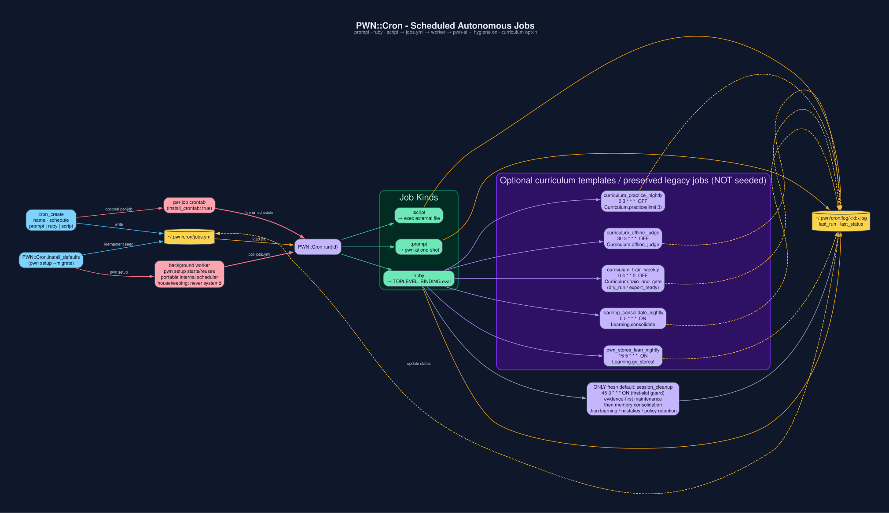

# Cron - Scheduled Autonomous Jobs

`PWN::Cron` (`lib/pwn/cron.rb`) stores job definitions in
`~/.pwn/cron/jobs.yml`. `pwn setup` starts (or reuses) a background cron
worker. Setup, migration and startup only seed internal job definitions;
they never install, start, repair or remove native scheduler units. After a
reboot, start/reuse the portable worker with `pwn setup --cron`; automatic
jobs require that worker, while manual commands do not. `--no-cron` disables
the internal worker without changing host services.

**Housekeeping must never use systemd or another native scheduler.**
The three enabled housekeeping defaults below use only this existing worker
or manual commands. `install_native_job` and each platform-specific job
installer explicitly skip housekeeping (`housekeeping_internal_only`),
including recognizable cleanup payloads under another name. Native worker
contexts exclude housekeeping from ticks and direct job execution.

Generic scheduler APIs remain for unrelated custom jobs: `install_crontab:
true` can still add their per-job system lines. They are not called by setup,
migration or default seeding. Existing housekeeping units/drop-ins are left
untouched and require explicit operator approval for removal; they are never
re-enabled automatically. See [Installation](Installation.md) for the legacy
service migration boundary. Do not create another worker or run cleanup just
to validate scheduling.



## Job kinds

| Kind | Executed as | Use for |
|---|---|---|
| `prompt:` | `pwn --ai "<prompt>"` one-shot | "Re-scan scope nightly and diff findings" |
| `ruby:` | `TOPLEVEL_BINDING.eval` in-process | Direct `PWN::Plugins` calls |
| `script:` | `exec` external file | Anything not in Ruby |

## Tools

| Tool | Purpose |
|---|---|
| `cron_create(schedule:, prompt:/ruby:/script:, install_crontab:)` | Define a job |
| `cron_list` | id · name · schedule · enabled · last_run · last_status |
| `cron_run(id:)` | Fire immediately (updates last_run/last_status) |
| `cron_enable` / `cron_disable` | Toggle without deleting |
| `cron_remove` | Delete from `jobs.yml` (does **not** scrub crontab - `crontab -e` yourself) |

## Default housekeeping and explicit curriculum opt-in

`PWN::Cron.install_defaults` seeds **one** enabled job on a fresh install:
`session_cleanup`, daily at `45 3 * * *`, guarded until its first scheduled slot.
It calls `SessionCleanup.coordinate` through the existing internal worker:

1. Shared maintenance: preflight, evidence migration, protected-session cleanup,
   and disposable storage maintenance.
2. Memory consolidation (`Learning.consolidate`, including Memory lean).
3. Learning outcome retention (`Learning.prune_outcomes!`).
4. Mistakes retention (`Mistakes.lean!`).
5. Policy trajectory retention (`Policy.lean!`).

The coordinator holds the permanent maintenance lock across these phases and
records their separate results. Blocked/incomplete maintenance skips retention;
dry-run does not consolidate memory or mutate stores. Store writer locks and
existing gold/recent/protected-entry policies remain in force. It does not call
`gc_stores!`, which would repeat memory consolidation and session cleanup.

Existing jobs are preserved verbatim, including disabled/custom schedules and
legacy curriculum aliases. Existing `learning_consolidate_nightly` and
`pwn_stores_lean_nightly` are **not** removed automatically. If either exists
when a missing session job is seeded, that job uses maintenance-only payloads
rather than duplicate retention. Consolidate those live schedules only after
all writers and the matched helper have been safely upgraded and tested.

Curriculum schedules are **not seeded at all**, including after deletion,
startup, or repeat migration. `CURRICULUM_JOBS` contains optional templates for
`curriculum_practice_nightly`, `curriculum_train_weekly`, and
`curriculum_offline_judge`. Explicitly create a selected template only when
wanted; templates default disabled:

```ruby
spec = PWN::Cron::CURRICULUM_JOBS.find { |job| job[:name] == 'curriculum_practice_nightly' }
PWN::Cron.create(spec.merge(enabled: false, sync_native: false))
```

Practice runs real tools, judge can spend provider tokens, and training needs
its own explicit configuration/approval. See [Reinforcement Learning](Reinforcement-Learning.md).

For schedule-only deletion without touching native schedulers, use
`PWN::Cron.remove(id: exact_id, sync_native: false)`. It preserves job logs and
other evidence. Registry writes use a permanent lock and atomic replacement;
completion updates merge into the current registry and never resurrect a deleted
job. Old workers without this protocol must drain safely before a registry edit;
never use a forced stop while a job is writing. A current worker reloads the
registry each tick; ordinary schedule changes need no restart.

## Example

```ruby
cron_create(
  name: 'nightly_scope_sweep',
  schedule: '0 2 * * *',
  prompt: 'extro_snapshot, then NmapIt sweep 10.0.0.0/24, extro_observe every '\
          'new open port, extro_correlate, and post a one-paragraph summary.',
  install_crontab: true
)
```

At 02:00 the system cron fires `PWN::Cron.run`, which spins up a headless
`pwn-ai` turn. With `auto_introspect` on (and optional `auto_extrospect` for
the cheap `AUTO_SECTIONS` baseline), the run updates Learning/Metrics - and,
if enabled, host/repo/env posture - so tomorrow's interactive session already
knows what changed overnight. Sense tools (`intel`/`verify`/`watch`) stay
on-demand; cron is not expected to launch Burp/ZAP/msf/GQRX.

```ruby
cron_create(
  name: 'memory_revalidate',
  schedule: '0 4 * * 0',
  ruby: 'PWN::AI::Agent::Extrospection.revalidate_memory'
)
```

Weekly, headless-browser fact-check of every `PWN::Memory` `:fact` containing
a CVE / version string / URL. Refuted entries get prefixed `[UNVERIFIED
yyyy-mm-dd]` so the injected MEMORY block stops calcifying into
confidently-wrong priors - see [Extrospection § revalidate_memory](Extrospection.md).

**See also:** [Sessions](Sessions.md) · [Extrospection](Extrospection.md) ·
[Reinforcement Learning](Reinforcement-Learning.md) · [CLI Drivers](CLI-Drivers.md)

[← Home](Home.md)
