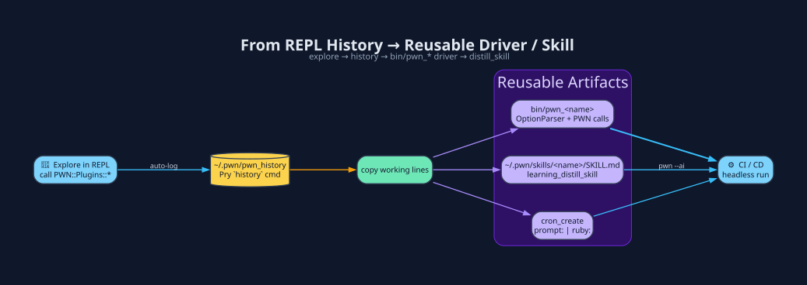

# Drivers - Turn a REPL Session into a Shipped Binary

A **driver** is a small executable in `bin/` that wires `OptionParser` to one
or more `PWN::` calls. The example below is a minimal pattern, not a claim
that every driver has the same options or implementation.



## Workflow

1. **Prototype in the REPL** until the calls work.
2. `history` → copy the winning lines.
3. Drop them into the template below as `bin/pwn_<name>`.
4. `chmod +x bin/pwn_<name>`; track it in Git for gemspec discovery and test it
   before `bundle exec rake install`. Do not commit or publish without review.
5. (Optional) `learning_distill_skill(name: '<name>')` so the agent knows the
   procedure too.

## Template

```ruby
#!/usr/bin/env ruby
# frozen_string_literal: true

require 'optparse'
require 'pwn'
require 'json'
require 'fileutils'

opts = {}
OptionParser.new do |o|
  o.banner = "USAGE: #{File.basename($PROGRAM_NAME)} [opts]"
  o.on('-tTARGET', '--target=TARGET', 'Required target') { |v| opts[:target] = v }
  o.on('-oDIR',    '--out=DIR',       'Output directory') { |v| opts[:out]    = v }
end.parse!

raise OptionParser::MissingArgument, '-t' unless opts[:target]

raise OptionParser::MissingArgument, '-o' unless opts[:out]
FileUtils.mkdir_p(opts[:out])
xml = File.join(opts[:out], 'scan.xml')
PWN::Plugins::NmapIt.port_scan(targets: opts[:target], xml: xml)
result = PWN::Plugins::NmapIt.inventory(xml_file: xml)
puts JSON.pretty_generate(result)
```

## Three artifact types from one REPL session

| Artifact | Made with | Consumed by |
|---|---|---|
| `bin/pwn_<name>` | template above | shell / CI |
| `~/.pwn/skills/<name>/SKILL.md` | `learning_distill_skill` | every future pwn-ai prompt |
| `cron` job | `cron_create(ruby: '...')` | system crontab → unattended |

**See also:** [CLI Drivers](CLI-Drivers.md) · [Cron](Cron.md) ·
[Skills, Memory & Learning](Skills-Memory-Learning.md)

[← Home](Home.md)
