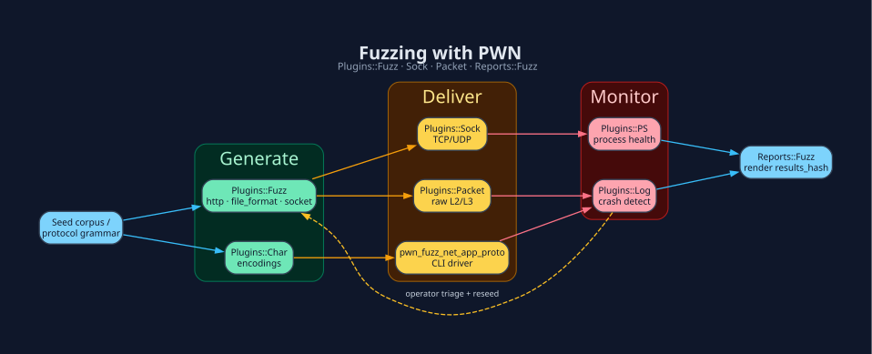

# Fuzzing - `PWN::Plugins::Fuzz` · `Sock` · `Packet`



> **Install:** `pwn setup --profile net` - pcaprub headers · tshark ·
> tcpdump. See [Installation](Installation.md).

## Generate

```ruby
payloads = PWN::Plugins::Fuzz.http(
  request: "GET /FUZZ HTTP/1.1\r\nHost: lab.invalid\r\n\r\n",
  dictionary: ['a', 'long-input', '%00']
)
```

## Deliver

```ruby
# For authorized network tests, Fuzz.socket accepts target:, port:, request:,
# payload: and fuzz_delimeter:. Inspect its help for timeout/encoding controls.
PWN::Plugins::Fuzz.help
```

For raw L2/L3: `PWN::Plugins::Packet`.
CLI network fuzzer: `pwn_fuzz_net_app_proto --help` (requires a payload **file**,
request template and output directory; not `-f seeds/`).

## Monitor & report

`Fuzz.http` expands templates only; it does not send traffic. `Fuzz.file_format`
appends dictionary blobs to a seed. `Fuzz.triage` deduplicates existing crash
files by hash and selects the smallest reproducer. `PWN::Reports::Fuzz.generate`
expects a `results_hash:` and output `dir_path:`; it is not a crash detector.
Use explicit target monitoring and retain actual crash evidence.

Feed unique crashes back as new seeds (`Log → Fuzz` dashed edge in the diagram).

[← Home](Home.md) · [Reporting](Reporting.md)
