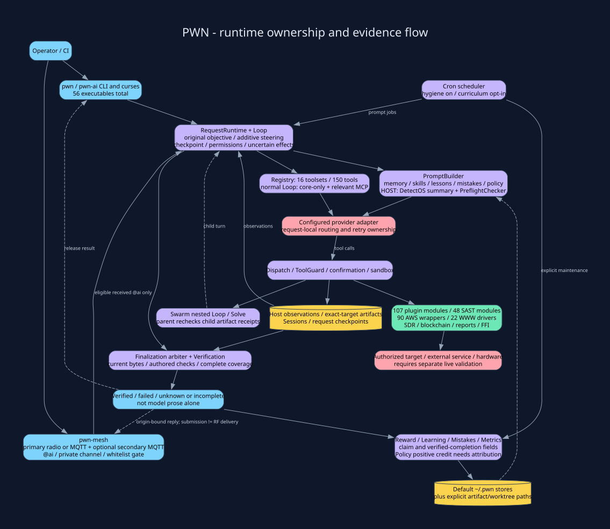
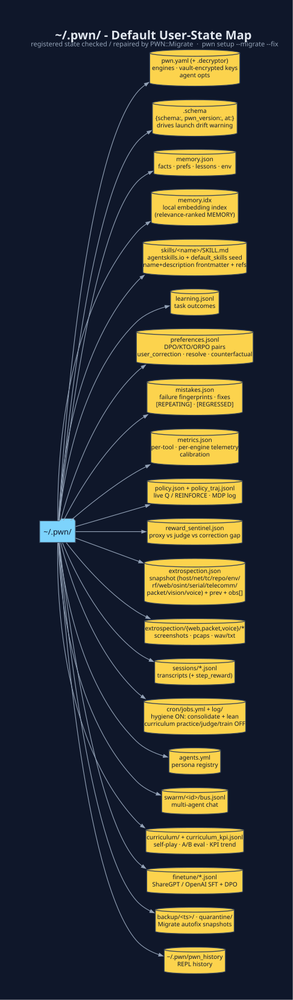
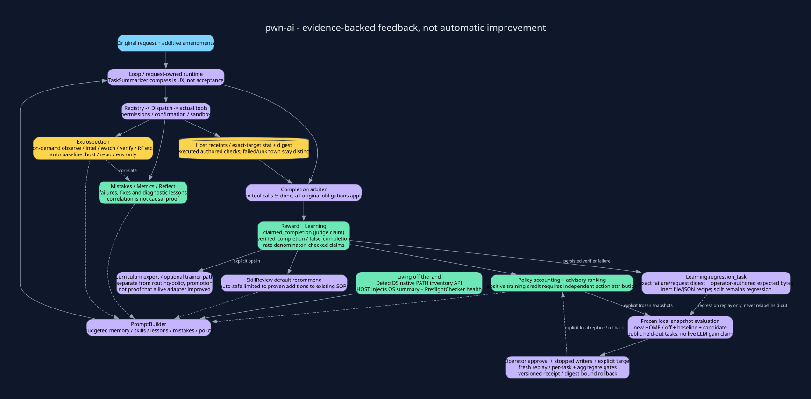

# How PWN Works

This conceptual layer map groups entry points, agent control, capabilities and
persistence. Feedback and cross-layer calls are explicit; layout is not a call graph.

## L0 - Actors

Humans (`pwn` REPL, `pwn-ai` TUI), CI runners (`pwn --ai "..."`, `bin/pwn_*`),
LLM providers (over HTTPS), and targets (hosts, web apps, clouds, radios,
hardware).

## L1 - Entry points (`bin/`)

| Entry | File | Purpose |
|---|---|---|
| `pwn` REPL | `lib/pwn/plugins/repl.rb` | Pry with `PWN::` pre-loaded + custom commands |
| `pwn-ai` | `lib/pwn/ai/agent/loop.rb` | Agent TUI inside the REPL |
| `pwn --ai PROMPT` | `bin/pwn` | Headless one-shot agent (CI-friendly) |
| `pwn setup` | `lib/pwn/setup.rb` · `bin/pwn_setup` | Post-install doctor + capability provisioner + `--migrate` state doctor (also `pwn --setup[=PROFILE]`) |
| `bin/` (including `pwn-ai` and `pwn-capd`) | 56 files | Thin OptionParser wrappers plus the `pwn` REPL / one-shot agent |
| `PWN::Cron` | `lib/pwn/cron.rb` | Scheduled jobs + background worker (`pwn setup`). Fresh install seeds hygiene on (`learning_consolidate_nightly`, `pwn_stores_lean_nightly`) and curriculum practice/judge/train off |

## L2 - AI agent core (`lib/pwn/ai/agent/`)

| Module | Role |
|---|---|
| `Loop` | plan → **TaskSummarizer** briefs → dispatch tool_calls → observe → repeat until `may_finalize?`. No iteration-budget abort |
| **`TaskSummarizer`** | Executive UX: every request gets an English task compass (`emit_plan!` · `about_to` as `task k/n`) - no statement/question/goal type |
| `Registry` | JSON-Schema function definitions grouped into 16 **toolsets** · **150 tools** · `CORE_TOOLS` = `DEFAULT_PREFERENCE` (`memory_recall` · `session_recall` · `skills_recall` · `pwn_eval` · `shell` · `mistakes_record` · `mistakes_resolve` · `learning_note_outcome` · `memory_remember` · `skills_update` · `artifact_read` · `artifact_grep` · `job_run` · `job_status` · `job_tail` · `job_result` · `job_kill`) |
| `Dispatch` / `Result` | execute a tool, capture stdout/value/error/duration |
| `PromptBuilder` | inject MEMORY / SKILLS / LEARNING / **KNOWN MISTAKES + FIXES** / METRICS / **POLICY** / EXTROSPECTION / RECENT TURNS |
| `Metrics` · `Learning` · `Reflect` · **`Policy`** | **introspection** - how well am I doing? (Policy is live Q / REINFORCE, advisory rank only) |
| `Mistakes` | **negative feedback** - fingerprint failures, do NOT repeat, `[REPEATING]`/`[REGRESSED]`, inline `correction_hint` |
| **`Reward`** | cheap LLM outcome `judge` (heuristic overlap last) · per-step process credit · `sentinel` (proxy vs ORM-weighted judge) · `semantic_ok` · DPO `preferences.jsonl` |
| **`Curriculum`** | mistake-driven self-play `practice` · `counterfactual` A/B · tool-armed `critic` · `red_team_plan` · `hindsight` (HER) · `train_and_gate` regression-gated LoRA |
| `Extrospection` | **extrospection** - on-demand world sensing (`intel` · **`verify`** · **`watch`** · **`rf_tune`** · **`osint`** · `serial` · `telecomm` · `packet` · `vision` · `voice`) + ambient baseline (host · net · toolchain · repo · env · **rf** · **web**) joined to introspection via `correlate` |
| `Swarm` | multi-agent personas over a shared JSONL bus |

See [Agent Tool Registry](Agent-Tool-Registry.md) for every tool the LLM can
call, and [Reinforcement Learning](Reinforcement-Learning.md) for how
`Reward` + `Curriculum` + `Policy` close the learning loop.

## L3 - Capability namespaces (`lib/pwn/*`)

`Plugins` (107) · `SAST` (48) · `WWW` (22) · `AWS` (90) · `SDR` · `Blockchain` ·
`Bounty` · `Reports` · `FFI` · `Banner` · **`Setup`** · **`Migrate`**. First launch also seeds bundled skills from `etc/default_skills/`. Each is
a plain module of `public_class_method def self.x(opts = {})` methods -
callable the same way from the REPL, from `pwn_eval`, or from a driver.

## L4 - Persistence (`~/.pwn/`)

Most default user state lives under `~/.pwn`; explicit outputs and worktrees may live elsewhere.
`PWN::Migrate` (schema-stamped, idempotent, dry-run capable) verifies and
autofixes every file in it after a `gem update pwn`:

See [Persistence](Persistence.md) for the layout of each file and
[Installation § Upgrading](Installation.md#upgrading--pwn-state-migration-pwnmigrate)
for the migrator.

## The feedback loop

L2 records outcomes and may propose skills or lessons; routine success does not
automatically create a skill. In the feedback loop, **failures become fingerprinted mistakes with fixes**, **world state
is sensed on demand** (`extro_verify` / `extro_watch` / `extro_rf_tune` /
`extro_osint` / `extro_serial` / `extro_telecomm` / `extro_packet` /
`extro_vision` / `extro_voice` / `extro_intel`) and correlated against those
failures, a **cheap LLM judge scores the final answer** (token overlap only if the engine is unavailable) and a **process reward
model tags each tool step**, **Policy records the live MDP step** and updates
Q / REINFORCE only for eligible resolved outcomes with independently attributed positive credit, and **the prompt blocks**
(MEMORY · SKILLS · LEARNING · KNOWN MISTAKES/FIXES · TOOL EFFECTIVENESS ·
POLICY · EXTROSPECTION · RECENT TURNS) are re-injected into the next system
prompt.
Nightly hygiene cron trims `~/.pwn` stores. Curriculum practice, offline
judge, and weekly LoRA train ship seeded but disabled; turn them on with
`cron_enable` when you want that loop.

`Metrics.esr` is `verified_exploit_tools / vulnerable_tools`. `Metrics.asr` is `successful_attacks / total_attack_attempts`. `Learning.rsi_tick` compares ESR with the previous snapshot and writes a lesson when it falls. A file hash, a nuclei template match, or a CVE id does not move ESR. Only a reproduced exploit does.

**Next:** [pwn REPL](pwn-REPL.md) · [pwn-ai Agent](pwn-ai-Agent.md) ·
[Reinforcement Learning](Reinforcement-Learning.md)

[← Home](Home.md)
