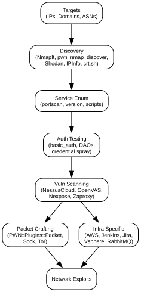

# `PWN::Plugins::NmapIt`

Thin, composable wrapper over `nmap` with structured XML parsing.



> **Install:** `pwn setup --profile net` - nmap · tshark · tcpdump ·
> pcaprub headers · whois. See [Installation](Installation.md).

```ruby
PWN::Plugins::NmapIt.port_scan(
  target: '10.0.0.0/24',
  ports:  '1-1024',
  service_scan: true,
  script:  'default,vuln',
  output_xml: '/tmp/scan.xml'
)
r = PWN::Plugins::NmapIt.inventory(xml_file: '/tmp/scan.xml')
r[:hosts].each { |h| puts "#{h[:host]} → #{h[:ports].map { |p| p[:port] }}" }
```

`port_scan` invokes `Nmap::Command.sudo`; it is not an unprivileged parser and
its return is not the inventory Hash. `inventory` reads an existing XML file.
Use `pwn_nmap_discover_tcp_udp --help` for the driver's separate options.

Pairs with `extro_observe` to persist banners for later
[correlation](Extrospection.md), and with `PWN::Plugins::Sock` /
`PWN::Plugins::Metasploit` for follow-up.

[← Home](Home.md) · [Plugins](Plugins.md)
