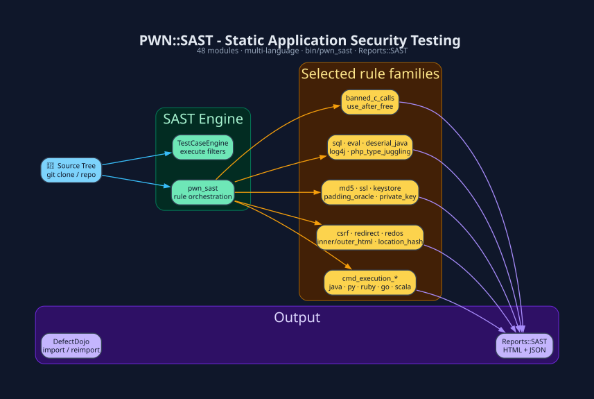

# `PWN::SAST` - Static Application Security Testing

48 top-level modules in `PWN::SAST`. `Factory` is the Java XML-factory/XXE
pattern rule, not the rule loader; `TestCaseEngine` executes rules.
The `pwn_sast` driver orchestrates the selected rules.
Source: `lib/pwn/sast/*.rb`. CLI: `bin/pwn_sast`.



## Run it

```bash
# CLI driver
pwn_sast --help  # inspect the installed driver's source/output options
```

```ruby
# REPL / pwn_eval
require 'fileutils'
rows = PWN::SAST::Factory.scan(dir_path: '/path/to/src')
FileUtils.mkdir_p('/tmp/sast_out')
PWN::Reports::SAST.generate(dir_path: '/tmp/sast_out',
                            results_hash: { data: rows },
                            report_name: 'report')
```

## Rule families (48 modules)

| Family | Modules |
|---|---|
| **Command execution** | `CmdExecutionJava` · `CmdExecutionPython` · `CmdExecutionRuby` · `CmdExecutionGoLang` · `CmdExecutionScala` · `Shell` · `Sudo` |
| **Web / DOM** | `CSRF` · `Redirect` · `ReDOS` · `InnerHTML` · `OuterHTML` · `LocationHash` · `WindowLocationHash` · `PostMessage` · `LocalStorage` · `BeefHook` |
| **Injection / eval** | `SQL` · `Eval` · `DeserialJava` · `Log4J` · `PHPInputMechanisms` · `PHPTypeJuggling` · `TypeScriptTypeJuggling` |
| **Crypto / secrets** | `MD5` · `SSL` · `Keystore` · `PaddingOracle` · `PrivateKey` · `Signature` · `Token` · `Password` · `Base64` · `HTTPAuthorizationHeader` |
| **Memory / native** | `BannedFunctionCallsC` · `UseAfterFree` |
| **Infra / meta** | `AWS` · `AMQPConnectAsGuest` · `ApacheFileSystemUtilAPI` · `PomVersion` · `Version` · `Port` · `Logger` · `ThrowErrors` · `TaskTag` · `Emoticon` |
| **Engine** | `Factory` (Java XML-factory/XXE rule) · `TestCaseEngine` (probe generator) |

## Write a rule

Each rule implements `self.scan(opts = {})` taking `dir_path:` and returning an
array of TestCaseEngine result rows (including timestamp, security references,
filename/line and raw/test-case content). Inspect an existing rule and the
report renderer rather than inventing a findings schema. Add its namespace
autoload, paired spec and generated module skill; the driver selects rules.

## Downstream

`PWN::Reports::SAST` → HTML + JSON → `PWN::Plugins::DefectDojo.importscan` →
`PWN::Plugins::JiraDataCenter` tickets.

**See also:** [Reporting](Reporting.md) · [CLI Drivers](CLI-Drivers.md)

[← Home](Home.md)
