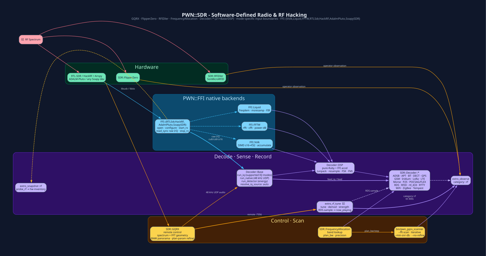

# `PWN::SDR` - Software-Defined Radio & RF



> **Install:** `pwn setup --profile sdr` - GQRX, rtl-sdr, hackrf, libiio /
> libad9361 (ADALM-Pluto), SoapySDR, libvolk, libliquid, libfftw3, libusb,
> multimon-ng, sox, libsndfile. See [Installation](Installation.md).

## Modules  (`lib/pwn/sdr/*.rb`)

| Module | Purpose |
|---|---|
| **`GQRX`** | Remote-control a running GQRX instance over TCP: tune, set demod, squelch, record, `get_spectrum_snapshot` (pure-Ruby FFT - median NF, relative peak/prominence, **plan-parametric** min-distance & -6 dB BW), `fast_scan_range` (**always RAW @ sample_rate** panoramic capture; band-plan IF deferred to refine/decoder; `#fft_plan_geometry` derives sep/merge/refine/snap from `(plan_bw, step, res)`; local-FFT refine + S-meter confirm; schema-parity with `scan_range`) |
| `FlipperZero` | Serial control of Flipper (sub-GHz, NFC, IR, iButton) |
| `RFIDler` | 125 kHz RFID reader/emulator |
| `SonMicroRFID` | SM130 13.56 MHz reader |
| `FrequencyAllocation` | ITU/FCC band-plan lookup - "what lives at 433.92 MHz?" |
| **`Decoder::*`** | 21 protocol demodulators/decoders (+ Base/DSP helpers) - `ADSB APT Bluetooth DECT FLEX GPS GSM Iridium LoRa LTE Morse P25 Pager POCSAG RDS RFID RTL433 RTTY Tempest WiFi ZigBee` |

## CLI

```bash
# FFT sweep - plan-parametric peak geometry + local-FFT refine for exact centers
# Works for ALL band plans (CW 150 Hz → FLEX 20 kHz → FM 200 kHz → GPS 30 MHz)
pwn_gqrx_scanner -a pager_flex --fft-scan                 # alias: flex_pager
pwn_gqrx_scanner -a fm_radio   --fft-scan --min-snr-db 18
pwn_gqrx_scanner -a am_radio   --fft-scan --no-refine
pwn_gqrx_scanner --scan-ranges 430.000.000-440.000.000 --fft-scan \
                 --avg 8 --min-snr-db 10 --capture-secs 0.10
# Skip refine (pure panoramic): add --no-refine
# Explicit S-meter lock (skips auto-cal from live NF): -S -55

# Classic iterative S-meter scan
pwn_gqrx_scanner -a aviation_vhf
pwn_gqrx_scanner -s 118.000.000-137.000.000 -D AM -b 25.000 -P 4 -S -60
```

### `--fft-scan` geometry (all 84 band plans)

Every detector/refine/merge knob is a pure function of the two band-plan
invariants already on each plan (`bandwidth` → `plan_bw_hz`, `precision` →
`step_hz = 10**(precision-1)`) plus spectrum resolution `res_hz = sample_rate/nfft`:

| Stage | Rule |
|---|---|
| Capture IF | **Always** `M RAW sample_rate` (IQRECORD is demod IF - never plan FM/20 kHz) |
| Peak height / prom | Relative: `median_nf + 12 dB`, prom ≥ 8 dB |
| Peak min-distance | `#fft_plan_geometry` → `sep_hz = max(0.5·plan, step, floor)` |
| Occupied BW | -6 dB-from-peak contour, hard-capped to `± plan_bw` |
| Center | Power-weighted centroid of -6 dB lobe → raster snap |
| Merge | `tol = max(½ plan, step, ½ measured_bw, 2·res)` |
| Refine window | ~0.6·plan (capped so next neighbour is outside); local high-res FFT |
| Strength lock | Auto from live S-meter NF + 8 dB unless `-S` given |

See skill `pwn_gqrx_scanner_fast_vs_iterative_scanning` for the full trade-off.

## REPL example

```ruby
g = PWN::SDR::GQRX.connect(target: '127.0.0.1', port: 7356)
PWN::SDR::GQRX.init_freq(gqrx_sock: g, freq: '433.920.000',
                        demodulator_mode: :AM, keep_alive: true)
snap = PWN::SDR::GQRX.get_spectrum_snapshot(gqrx_sock: g, nfft: 2048)
plans = PWN::SDR::FrequencyAllocation.band_plans
PWN::SDR::GQRX.disconnect(gqrx_sock: g)
```

This is active tuning of an already running GQRX instance, not an offline test.

## Native DSP acceleration (`PWN::FFI`)

`PWN::SDR::Decoder::DSP` transparently accelerates hot paths when the host
has the matching shared libraries:

| DSP method | Backend | Library |
|---|---|---|
| `unpack_s16le` | `PWN::FFI::Volk` | libvolk |
| `resample` | `PWN::FFI::Liquid` | libliquid |
| `dc_block(m:)` | `PWN::FFI::Liquid` | libliquid |
| `rms_dbfs` (≥64) | `PWN::FFI::Volk` | libvolk |

```ruby
PWN::FFI.backends
# => {AdalmPluto: true, FFTW: true, HackRF: true, Liquid: true, RTLSdr: true, SoapySDR: true, Volk: true}

# Force pure-Ruby (e.g. for tests / A/B)
PWN::SDR::Decoder::DSP.native = false
```

Front-end inventory & raw I/Q capture (uniform across every `PWN::FFI` radio):

```ruby
PWN::FFI::SoapySDR.list_devices
PWN::FFI::RTLSdr.list_devices
PWN::FFI::AdalmPluto.list_uris
PWN::FFI::HackRF.info

# One-shot capture (any front-end exposes .capture / .read_sync)
iq = PWN::FFI::HackRF.capture(freq_hz: 433_920_000, rate_hz: 10e6, samples: 262_144)
```

See [FFI](FFI.md) for the full binding surface and design rules.

## Decode input boundaries

The current registry has 24 aliases mapping to 21 protocol modules, including
`Tempest`; `Flex` is the Ruby constant behind `:flex`. It is not a claim of full
protocol or live-air coverage. See the mode-by-mode
[SDR Decoder Coverage](SDR-Decoder-Coverage.md) matrix before choosing a source.

Use each public decoder's `.help` and explicit `source: :file`, `file:`,
`sample_rate:` and `iq_format:` controls for an offline replay. Do not call
`GQRX.init_freq(decoder: ...)` merely to construct a fixture: it can start decoding
and perform live I/O. Audio, MPX, amplitude traces, synchronized symbols and raw
IQ are different inputs; a parser success does not prove RF acquisition.

`Base.run_iq` streams supported integer IQ sources through DSP to a supplied
demodulator. Its low-level default permits an energy-detector fallback, but
protocol `.decode` methods can require `fallback: :raise`. An energy observation
is never payload decoding. Explicit `.detect` exposes detection separately.
RDS's default GQRX polling is station metadata, while its native `redsea` backend
accepts MPX. GPS, LTE, RTL433 and RFID have mode-specific native boundaries;
missing executables/libraries and unsupported modes must remain visible.

## RF ↔ Extrospection

The AI agent is RF-aware. Two layers:

| Layer | Call | Role |
|---|---|---|
| **Passive inventory** | `extro_snapshot(sections: [:rf])` → `probe_rf` | RTL-SDR / HackRF / SoapySDR / Flipper / GQRX-socket presence |
| **Active sense organ** | **`extro_rf_tune(freq: "101.1")`** | Connect to a *running* GQRX remote-control socket, tune, demod, measure strength, sample RDS → `now_playing` / `station` |

```ruby
# record a recon finding
extro_observe(source: 'gqrx', category: :rf, target: '433.920MHz',
              data: 'peak -34.2 dBFS bw=200k FSK - likely garage remote')

# ask the radio a question (RDS on FM broadcast)
extro_rf_tune(freq: '101.1')
# → { ok:true, freq:"101.1 MHz", strength_dbfs:-2.8, station:"X96",
#     now_playing:"Mr. Brightside by The Killers", rds:{pi,ps_name,radiotext}, ... }
# → observe(category: :rf, ttl: 300)   # songs are ephemeral
```

RDS sampling is `PWN::SDR::Decoder::RDS.sample` (non-interactive Hash). The
TTY spinner (`Decoder::RDS.decode`) stays the human path used by
`GQRX.init_freq(decoder: :rds)`. Agents and cron use `extro_rf_tune` /
`.sample(interactive: false)`.

`extro_correlate` then cross-references `:rf` observations against missing
`RF_BINS` / unplugged hardware so the agent can tell "no signal" from "no
dongle" / "GQRX remote control is down".

**See also:** [Hardware](Hardware.md) · [Extrospection](Extrospection.md)

[← Home](Home.md)
