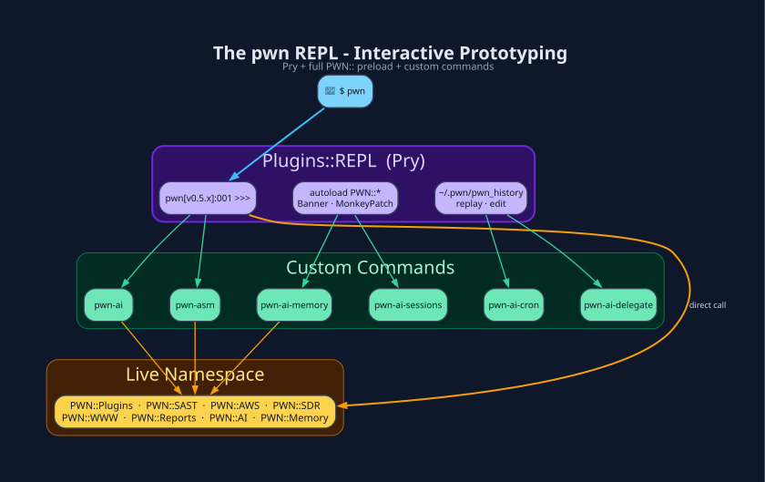

# The `pwn` REPL

`pwn` launches a **Pry** session with the entire `PWN::` namespace already
`require`d, a themed prompt, a persistent history file, and a set of custom
commands.



## Why Pry (not IRB)?

- `ls PWN::Plugins::BurpSuite` - instant method listing
- `show-source` / `show-doc` - read any plugin without leaving the shell
- `edit -m` - patch a method live and retry
- `wtf?` - full backtrace of the last exception
- `history --replay 5..12` - re-run a range of lines

## Custom commands

### pwn-ai session titles

`/sessions list` shows stable IDs and titles of at most seven
whitespace-separated words, matching the SESSION pane. The first request seeds
a provisional title; the currently active LLM provider and selected model produce a concise conversation title
after completed turns, with a deterministic seven-word fallback cap. The limit
also applies to explicit titles. It does not shorten requests or apply to the
rolling conversation summary.

Title generation runs asynchronously after completed turns, never during drawing
or keystrokes. It uses the previous overall summary plus new conversation turns,
without changing the active provider or falling back to a different model. Missing
credentials or failed/invalid responses retain the prior or provisional title;
background title work never starts interactive authentication. Artifact summaries
retain their separate local-only routing policy.

Existing overlong titles are normalized when read, without rewriting transcripts
or metadata merely to list them. `/sessions resume <title-or-id>`
accepts the exact displayed title, optionally quoted. Internal quotes
and Unicode whitespace are supported. If shortened titles collide, use the
stable ID shown in the ambiguity message; IDs and transcript filenames do not
change.
Previously displayed titles remain resume aliases when a background summary
renames the session, so a name copied from the list does not expire while typing.
Aliases shared by multiple sessions are ambiguous too; use a stable ID.

`dependencies` means **referenced by**: files containing defined structural
references to that session. Transcript prose, prompts, tool results and quoted
JSON—including previous `/sessions list` output—are not dependencies. An empty
array means no known structural references; `dependency_errors` separately
reports uncertainty and blocks scheduled cleanup. Dependency-backed sessions
stay visible and resumable. See Installation's session-cleanup schema table.
`title_source`, `is_summarized`, `classification` and `title_reason` expose the
same strict provenance used by cleanup. Only persisted `summary` provenance with
a nonblank summary/title and positive integer summary cursor counts as named.
Provisional, manual, persona, historical and alias titles do not prove LLM work;
legacy records explicitly report missing provenance. Unknown/malformed metadata
is protected without being called summarized. Neither listing nor cleanup calls
the LLM to manufacture provenance.

| Command | Implemented in | Purpose |
|---|---|---|
| `pwn-ai` | `Agent::Loop` | Enter the AI agent TUI |
| `pwn-vault` | `PWN::Plugins::Vault` | Decrypt, edit `~/.pwn/pwn.yaml`, re-encrypt. Stays in the editor until `PWN::Config` accepts the file. |
| `pwn-asm` | `Plugins::Assembly` | Multiline asm ↔ opcodes workbench |
| `pwn-mesh` | `Meshtastic` gem | Meshtastic serial / bluetooth / TCP / MQTT client (Ruby ≥ 4.0; `plugins.meshtastic.transport`). Inside the mesh TUI, leading-slash menus (`/channel`, `/transport`, `/device`, `/status`, `/help`, `/back`) configure the session locally and are not sent as mesh text. TAB completes those commands. |
| `pwn-ai-memory` | `PWN::Memory` | View/edit persistent memory |
| `pwn-ai-sessions` | `PWN::Sessions` | List/view/delete transcripts |
| `pwn-ai-cron` | `PWN::Cron` | List/run/toggle scheduled jobs |
| `pwn-ai-delegate` | `Agent::Swarm` | Send one request to a persona |
| `toggle-debug` | `Agent::Loop` / `Plugins::Log` | Stage log per operator request to `~/.pwn/logs/pwn-ai-DEBUG-<SESSION_ID>-R<N>.log` |
| `toggle-trace` | `Agent::Loop` / `Plugins::Log` | Turns `toggle-debug` on with TracePoint; ENTER after each engine/tool step. Pry.config, not Env. Off turns both off. |
| `toggle-pwn-ai-speaks` | `Plugins::Voice` | TTS every final answer on/off |
| `welcome-banner` | `PWN::Banner` | Redraw a random banner |
| `toggle-pager` | Pry | Page long output on/off |
| `back` | - | Leave `pwn-ai` / `pwn-asm` / `pwn-mesh` sub-REPL |

## pwn-mesh slash commands

Typed at the mesh TX prompt (leading `/`). `/` or `/menu` opens a boxed curses menu (arrows/j/k, Enter, Esc). `/channel`, `/transport`, and `/device` without an argument open the same kind of list. Explicit `/channel LongFast` still jumps without a menu. Commands are local — they are not published as Meshtastic text. Changes update `PWN::Env[:plugins][:meshtastic]` and persist to `~/.pwn/pwn.yaml` when the vault decryptor is available; a live session reconnects so RX follows the new channel or radio.

| Command | Purpose |
|---|---|
| `/help` | List mesh slash commands |
| `/status` | Show active transport, device, and channel |
| `/channel list` | List named `plugins.meshtastic.channel` blocks (`*` = active) |
| `/channel <name>` | Switch the active channel (e.g. `LongFast`) |
| `/transport list` | List `auto` / `serial` / `bluetooth` / `tcp` / `mqtt` |
| `/transport <kind>` | Pin a connection type (`auto` re-enables serial → bluetooth → tcp → mqtt probe) |
| `/device list` | List serial ports, BLE Meshtastic addresses, or the configured TCP/MQTT host |
| `/device <id>` | Switch radio for the active transport (`/dev/ttyACM0`, BLE MAC, `host:port`) |
| `/msg [!nodeid|channel] <text>` | Send a DM to `!nodeid`, or a broadcast on a named channel. Omit the target to reuse the last incoming DM sender or channel. A compose line without `/msg` goes to the active channel. Also `@!aabbccdd text` on a normal send. |
| `/toggle-dispatch-to-pwn-ai` | Off by default. When on, pwn-ai answers only if the source channel is encrypted, listed in `plugins.meshtastic.ai_whitelist`, and the text begins with `@ai`. DMs are allowed when they reside on a whitelisted channel. Uses `PWN::Env[:ai][:active]`. |
| `/back` | Leave pwn-mesh (same as `back` / CTRL+D) |

Typing `/` shows matching commands in the TX pane (ncurses hides Reline's dropdown). TAB still completes `/…` commands, channel names, transports, and device ids.

In COMPOSE, Up recalls older submitted lines and Down recalls newer ones.
Moving past the newest entry restores the draft and cursor position from before
history browsing. Recalled lines can be edited without changing saved entries.
History includes messages and slash commands, skips blank lines and consecutive
duplicates, and keeps the latest 100 entries in memory for the current pwn-mesh
session only; it is not written to disk.

### Message transport labels

Each CONVERSATION header ends with `RX via <TRANSPORT>` or `TX via <TRANSPORT>`.
SENDER and RECEIVER do not show that label. Ctrl+T cycles COMPOSE,
CONVERSATION, SENDER, and RECEIVER. In `auto` mode this is the
resolved connection, not the configured `auto` value. Received messages retain the subscribing transport's
origin through queued rendering, even if the current transport changes.
Missing origin metadata is shown as `Unknown`, not guessed from the current pin.
GPS is not part of the header. SENDER and RECEIVER sit to the right of
CONVERSATION. A broadcast receiver shows the channel name.

Headers use `timestamp encryption · SHORT NAME · source path · destination path · RX via <TRANSPORT>`,
with exactly one space on either side of each `·`. RX uses the sender's
`User.short_name` (`shortName` in JSON); TX uses the sending local node's User,
never the destination's name. Device connections use their NodeInfo/NODEINFO
inventory. MQTT learns NODEINFO announcements in a bounded, connection-local
inventory (up to 1000 users), including the sending identity if advertised.
Names are captured with each message, so later inventory or binding changes do
not rename queued messages. Missing or blank short names omit that field and
its separator; long names, node-ID fragments and gateway names are not substitutes.
ANSI CSI sequences are removed, control/newline characters and literal `·` in
names become spaces, and surrounding Unicode whitespace is trimmed. Other
Unicode text and internal spaces are retained. Names are labels, not authenticated identities.

For example (placeholder node IDs):

```text
2026-01-02 03:04:05+0000 🔍 · PEER · US/CA/2/e/LongFast/!aabbccdd · US/CA/2/e/LongFast/#
2026-01-02 03:04:06+0000 🔍 · SELF · US/CA/2/e/LongFast/!bbccddee (ME) · US/CA/2/e/LongFast/#
```

The timestamp, encryption indicator, source/destination paths, channel and
`(ME)` marker keep their existing meaning. The suffix identifies the local
client connection, not every RF or broker hop. A TX header means local transport
submission; it does not confirm over-the-air delivery or peer receipt.

### Encrypted DMs and key discovery

On serial, Bluetooth, or TCP, a DM checks the destination's public key in the
connected radio's NodeInfo records. If missing, pwn-mesh sends its own public
NodeInfo to that destination with a response requested and waits up to 15 seconds.
Only after obtaining the destination key does it submit the text with PKI
encryption explicitly required. Both radios must be reachable over the selected
channel; this does not verify a peer's identity outside Meshtastic's key exchange.

Discovery failure sends no DM text. The most recent failed attempt is retained
in session memory; bare `/msg` retries it using the current connection and active
channel. A new DM replaces that retained attempt, and exiting the process loses
it. Retention ends after transport submission, not a delivery acknowledgement;
later radio failures are displayed separately. There is no plaintext or
channel-PSK downgrade. Missing local public-key metadata requires a reconnect.

MQTT channel broadcasts remain supported, but PKI DMs are not implemented for
the broker transport. MQTT DM attempts remain unsent with an explicit error;
switch to serial, Bluetooth, or TCP and use `/msg` to retry.

## Multi-line input

`pwn-asm` and the legacy line-mode AI console use `PWNMultiLineInput`. The
default pwn-ai curses console owns its own input/render loop; see its
[current key table](pwn-ai-Agent.md). In the line reader, plain
**ENTER** submits; insert a newline (keep composing) with **any** of:

| Keystroke | Works on | Notes |
|---|---|---|
| **SHIFT + ENTER** | kitty · wezterm · foot · alacritty · ghostty · xterm · Konsole · iTerm2 · Windows Terminal · Terminator¹ | preferred; requires the emulator to encode modified Enter |
| **ALT + ENTER** | *everything*, incl. all VTE terminals | universal fallback - every emulator sends `\e\r` |
| trailing **`\`** + ENTER | *everything* | bash/irb/psql-style continuation; `\` is stripped on submit |

¹ Terminator (and every other libvte host - GNOME Terminal, Tilix,
xfce4-terminal, Guake, Ptyxis) cannot distinguish SHIFT+ENTER from
ENTER at the escape-sequence level ([GNOME/vte #2601](https://gitlab.gnome.org/GNOME/vte/-/issues/2601),
[#2607](https://gitlab.gnome.org/GNOME/vte/-/issues/2607)). For
Terminator specifically, pwn ships a GTK plugin that fixes it - install
with:

```console
$ pwn setup --terminal
```

This is **opt-in** and **one-time**: it copies
`third_party/terminator/pwn_shift_enter.py` →
`~/.config/terminator/plugins/`, enables it in
`~/.config/terminator/config` (backup taken), and prints the
`~/.tmux.conf` lines below. pwn will **never** touch your terminal
emulator's config on its own.

> **tmux users:** requires `set -s extended-keys on` **and**
> `set -as terminal-features '<outerTERM>*:extkeys'`. pwn sets both at
> runtime and tells you what to add to `~/.tmux.conf`; `pwn setup
> --terminal` prints the same. See
> [Troubleshooting](Troubleshooting.md#shiftenter-submits-instead-of-newline).

## History → Driver

`~/.pwn/pwn_history` captures every line you type. When a sequence works, turn it
into a shipped `bin/pwn_*` driver - see
[From REPL History to Driver](Drivers.md).

**Next:** [pwn-ai Agent](pwn-ai-Agent.md) · [CLI Drivers](CLI-Drivers.md)

[← Home](Home.md)
